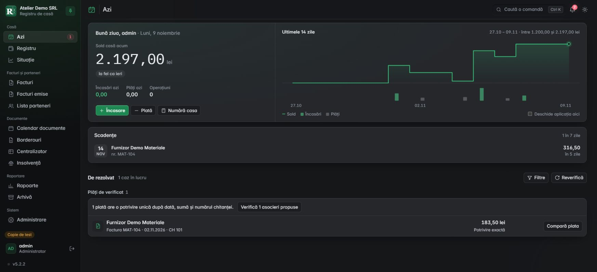
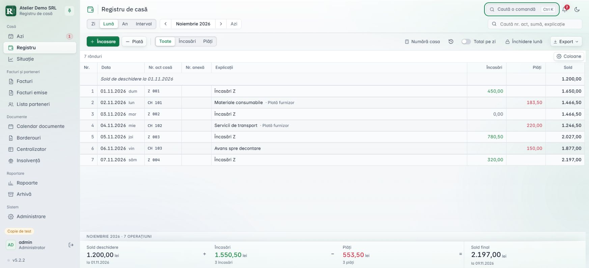
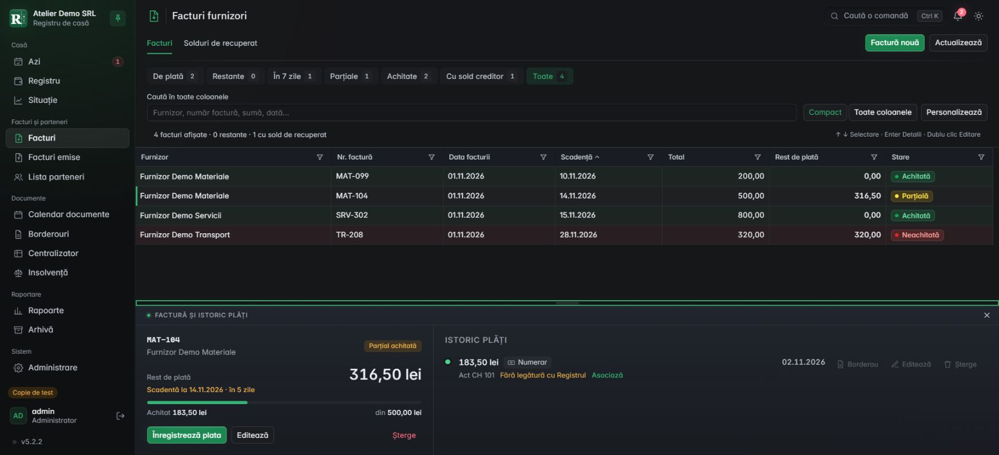
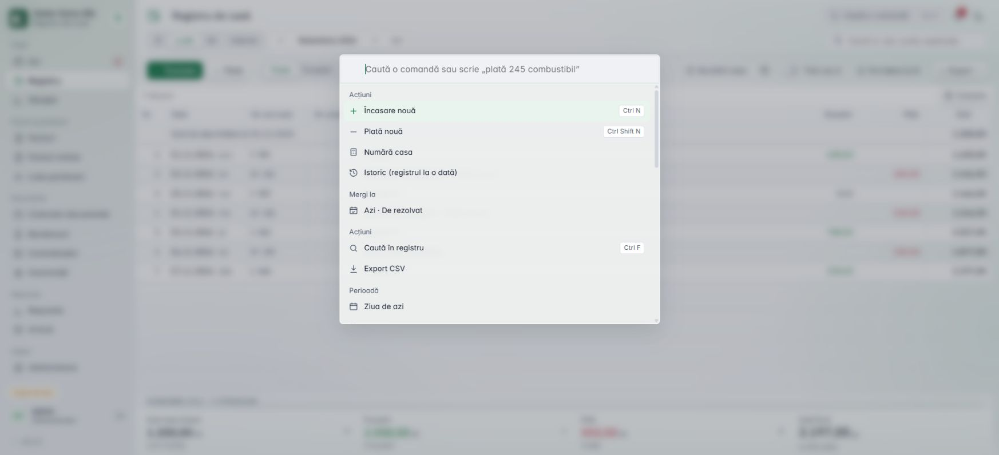

# Registru de Casă

**Registru de Casă Web** este ediția principală pentru Windows. Aplicația rulează local și reunește registrul de casă, facturile, borderourile și arhiva de documente.

[**Descarcă Web 5.2.2 pentru Windows**](https://github.com/cosminalex61/registru-casa/releases/download/v5.2.2/RegistruCasa.zip) · [Noutăți în 5.2.2](https://github.com/cosminalex61/registru-casa/releases/tag/v5.2.2)

  

## Registru de Casă Web

- **Azi** arată soldul casei, scadențele și operațiunile de verificat.
- **Registru** ține evidența încasărilor și a plăților, cu sold rulant, filtre pe perioadă și istoric al modificărilor.
- **Facturi** urmărește scadențele, plățile parțiale și soldurile de recuperat. Facturile emise au un ecran dedicat.
- **Borderouri și arhivă** reunesc pregătirea documentelor, centralizatoarele, previzualizarea PDF și ciornele Gmail cu atașamente.
- **Paleta de comenzi rapide** oferă acces la acțiuni și pagini din tastatură cu <kbd>Ctrl</kbd> + <kbd>K</kbd>.

Toate capturile sunt din Web 5.2.2 și folosesc date fictive.

| Registru · tema luminoasă | Facturi · tema întunecată |
| --- | --- |
|  |  |

   
  <em>Paleta de comenzi rapide, cu efect de sticlă peste registru.</em>

### Instalare și actualizare

Descarcă și extrage arhiva Web, apoi pornește `RegistruCasa.exe`. Pentru o instalare Web existentă, intră ca administrator în **Administrare → Actualizare → Verifică actualizări**. [Manifest și sumă SHA-256 pentru Web](version-web.json)

Aplicația păstrează evidența într-o bază locală SQLite. Integrarea Gmail folosește OAuth și se activează la cererea utilizatorului. [Politica de confidențialitate](https://cosminalex61.github.io/confidentialitate.html)

## Istoric · ediția desktop Qt

**Qt 4.0.3** este ultima versiune a ediției anterioare, construită cu PySide6. Pachetul Windows și notele versiunii rămân disponibile separat. [Release Qt 4.0.3](https://github.com/cosminalex61/registru-casa/releases/tag/v4.0.3) · [Manifest și sumă SHA-256 pentru Qt](version.json)
